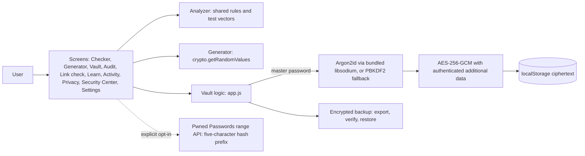

# Architecture

Everything runs in the browser. There is no application server or database; `serve.py` is only a static-file development server that adds security headers.

## Trust boundaries
- The local profile name is a namespace/label only, not authentication. The master password is the vault protection.
- Plaintext entries and the derived key exist in memory while the vault is unlocked. Same-origin malicious scripts or device malware can access them.
- On disk, vault records contain ciphertext, salt, IV and KDF parameters. App settings are stored separately and should not contain secrets.
- Network access is not required for analysis, generation or local vault operations. The optional breach check sends a partial SHA-1 hash prefix only.

## Storage formats
- Vault record `mpv3:<profile-id>`: PBKDF2 format v4 or Argon2id format v5; authenticated additional data binds the record to its version and profile ID.
- Backup file: PBKDF2 format v3 or Argon2id format v4; authenticated additional data binds the backup format version.

## Code map
- `web/index.html`: markup and styles; `web/app.js`: application logic; `web/vendor/sodium.js`: bundled libsodium; `web/sw.js`: offline cache.
- `web/_headers` and `hosting/nginx.conf`: deployment security headers; `serve.py`: local server with headers.
- `shared/rules.json` and `shared/test_vectors.json`: analyzer parity; `tests/` and `tests/ui/`: automated tests; `tools/`: report and deployed-header checker.
